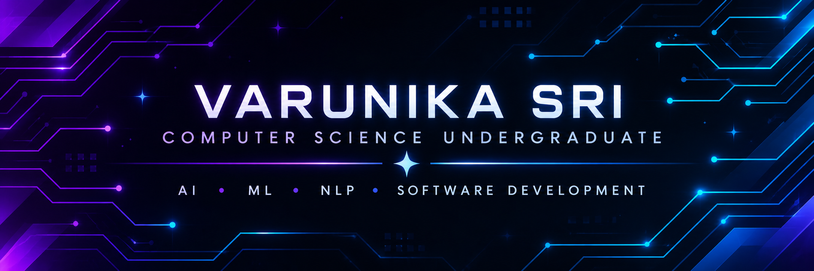

  

# Hey, I'm Varunika Sri! 👋

### Computer Science Undergraduate | IIIT Kottayam

I enjoy exploring technology, experimenting with ideas, and building things that solve real problems.

Currently exploring the intersection of **Artificial Intelligence, Machine Learning, NLP, and Software Development**.

---

### 👩‍💻 About Me

- 🎓 Computer Science Engineering student at IIIT Kottayam.
- 🔬 Interested in AI/ML research and multilingual NLP.
- 💡 Building projects across software development and applied AI.
- 🌱 Constantly learning, experimenting, and improving.
- 🤝 Interested in collaboration, research, and opportunities to build.

---

### 🛠️ Tech Stack

**Languages**

`C` `Java` `Python` `JavaScript` `SQL`

**Web Development**

`HTML` `CSS` `JavaScript` `React` `Next.js`

**Areas of Interest**

`Artificial Intelligence` `Machine Learning` `NLP` `Data Analytics`

**Tools**

`Git` `GitHub` `VS Code`

---

### 🚀 Projects & Experiments

| Project | Description |
|---|---|
| Hire Ready AI | An AI-powered resume and career preparation project |
| Pulse | Machine health monitoring and simulation project |
| Cosmic Piano | Interactive piano application built with Python |
| Multilingual QA System | Exploring multilingual question answering using language models |

---

### 📚 Currently Exploring

- Transformer architectures and BERT
- Machine Learning and applied AI
- Data Structures and Algorithms
- Full-stack development
- Research in multilingual language technologies

---

### 🤝 Connect With Me

- LinkedIn: [Connect with me](YOUR_LINKEDIN_URL)
- GitHub: [@varunika2222-cyber](https://github.com/varunika2222-cyber)

---

*Building my skills, one project at a time.*
